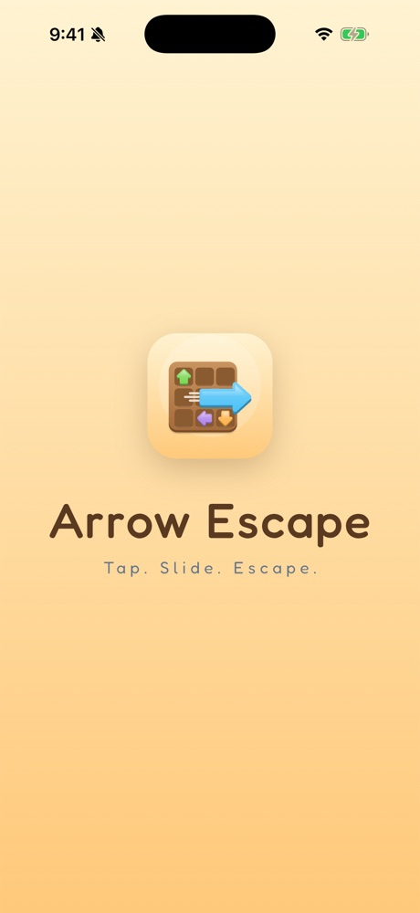
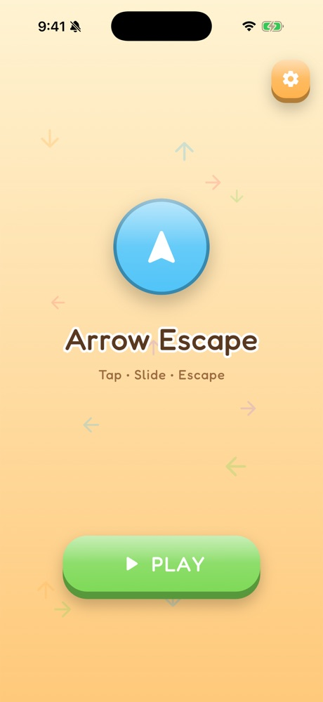
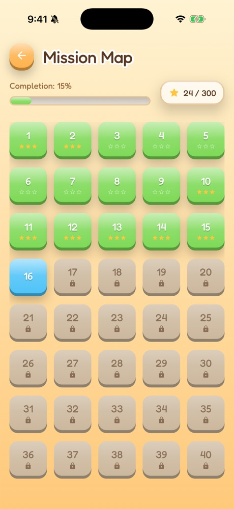
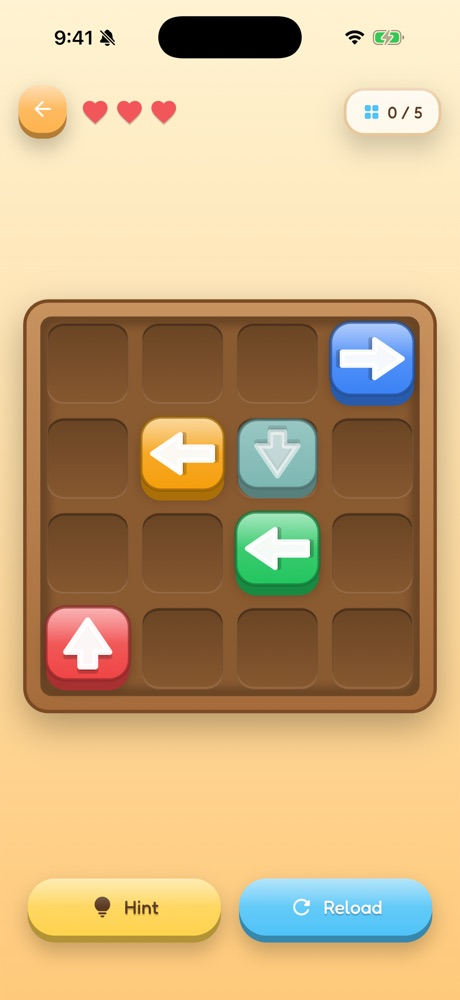
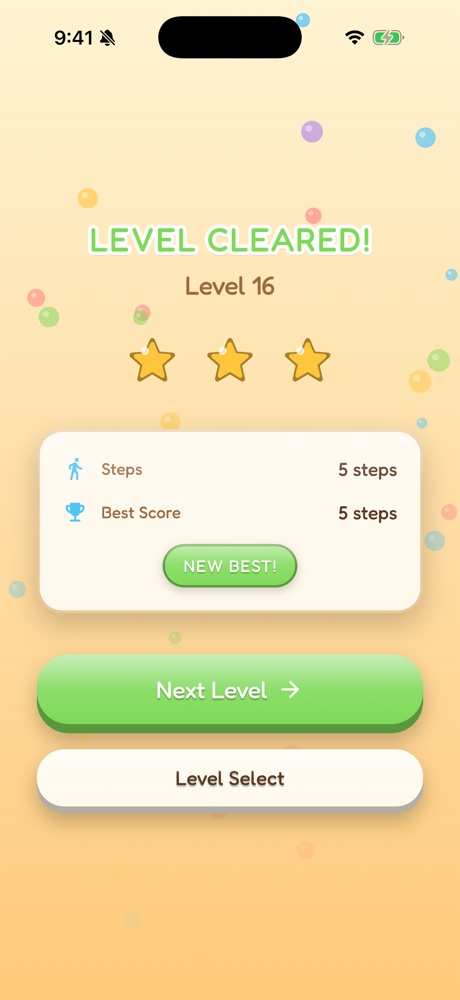
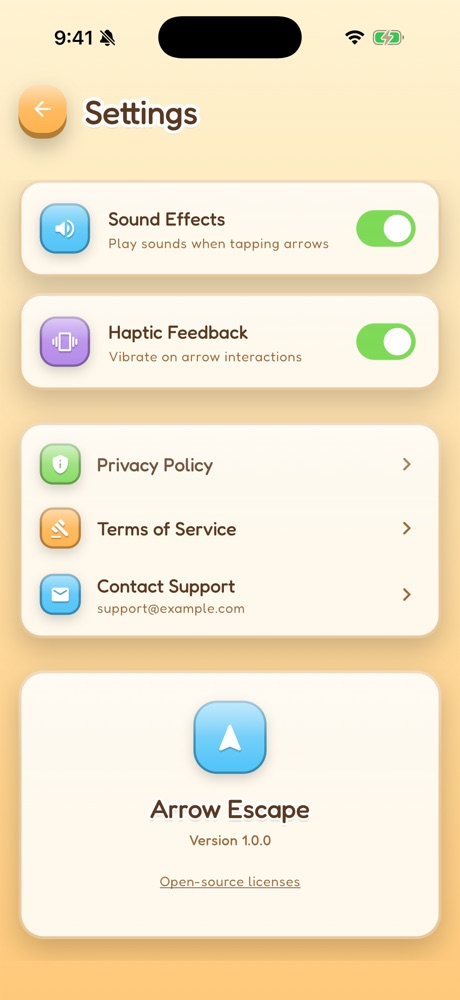

<p align="center">
  
</p>

<h1 align="center">Arrow Escape</h1>

<p align="center">
  <b>Tap. Slide. Escape.</b><br />
  A cozy grid puzzle where every arrow wants out. Clear the board in the right order.
</p>

<p align="center">
  
  
  
</p>

---

## Screenshots

<p align="center">
  
  
  
</p>
<p align="center">
  
  
  
</p>

## How to play

Each arrow can only slide in the direction it points. Tap an arrow and it escapes
the board if its path is clear. If something blocks it, you lose a heart.

- **3 hearts** per attempt. Run out and the level fails.
- **Stars**: 3 for a perfect solve, 2 for near-perfect, 1 for any clear.
- **Hint** highlights the next correct arrow. **Reload** restarts the level.

## Features

- 100 levels, each generated with a known solution, from 3×3 up to 7×7 boards
- Tactile, toy-like look: wooden board, glossy candy arrows, warm palette
- Progress, stars and best scores saved on the device
- Sound effects and haptics, each with an on/off switch
- Works fully offline, with no account or backend
- Built-in Privacy Policy, Terms of Service and open-source licenses
- Interstitial ads (Google AdMob) with GDPR/UK consent through Google UMP

## Getting started

Requires the [Flutter SDK](https://docs.flutter.dev/get-started/install) (Dart 3.11+).

```bash
flutter pub get
flutter run
```

Run the tests:

```bash
flutter test
```

Debug builds always use Google's test ad units, so you can develop safely.

## Project structure

The app follows Flutter's recommended layered architecture (MVVM with repositories).

```
lib/
├── main.dart                 # App entry, service wiring and routes
├── app_info.dart             # App name, version, support email
├── data/
│   ├── models/               # JSON models (levels, progress)
│   ├── repositories/         # Level and settings repositories
│   └── services/             # Storage, audio, ads, level loading
├── domain/
│   ├── models/               # Arrow, Level, GameState
│   └── use_cases/            # GameLogic: move rules, win check
└── ui/
    ├── core/                 # Theme, palette (skeuo.dart), shared widgets
    └── features/             # One folder per screen: views + view models
        ├── splash/  home/  level_selection/  game/
        ├── level_complete/  level_failed/
        ├── settings/  legal/
assets/
├── data/levels.json          # The 100 levels
├── sounds/                   # Tap, slide and complete effects
└── icons/                    # App icon (SVG + launcher sources)
tool/
└── generate_levels.dart      # Regenerates levels.json
```

### Useful commands

| Task | Command |
| --- | --- |
| Regenerate levels | `dart run tool/generate_levels.dart` |
| Regenerate launcher icons | `dart run flutter_launcher_icons` |
| Static analysis | `flutter analyze` |

## Release setup

Before publishing, do the following.

**1. App details.** Set your name and a real support email in
[`lib/app_info.dart`](lib/app_info.dart). They appear in the legal pages.

**2. Android signing and AdMob App ID.** Create `android/key.properties`
(git-ignored):

```properties
storeFile=/absolute/path/upload-keystore.jks
storePassword=...
keyAlias=upload
keyPassword=...
ADMOB_APP_ID=ca-app-pub-xxxxxxxxxxxxxxxx~yyyyyyyyyy
```

**3. iOS AdMob App ID.** Replace `GADApplicationIdentifier` in
`ios/Runner/Info.plist` (it currently holds Google's test ID).

**4. Ad unit IDs.** Pass them at build time. If they're missing, release builds
turn ads off rather than serving test ads.

```bash
flutter build appbundle --release --obfuscate --split-debug-info=build/symbols --dart-define=ADMOB_INTERSTITIAL_ANDROID=ca-app-pub-xxx/yyy
```

```bash
flutter build ipa --release --obfuscate --split-debug-info=build/symbols --dart-define=ADMOB_INTERSTITIAL_IOS=ca-app-pub-xxx/zzz
```

**5. Privacy Policy URL.** Both stores need a public link. Host the text from
[`lib/ui/features/legal/legal_content.dart`](lib/ui/features/legal/legal_content.dart).

## Tech stack

| Area | Package |
| --- | --- |
| Storage | `shared_preferences` |
| Audio | `audioplayers` |
| Ads and consent | `google_mobile_ads` (AdMob + UMP) |
| Fonts | `google_fonts` (Fredoka) |
| Vector graphics | `flutter_svg` |
| Icons | `flutter_launcher_icons` |
